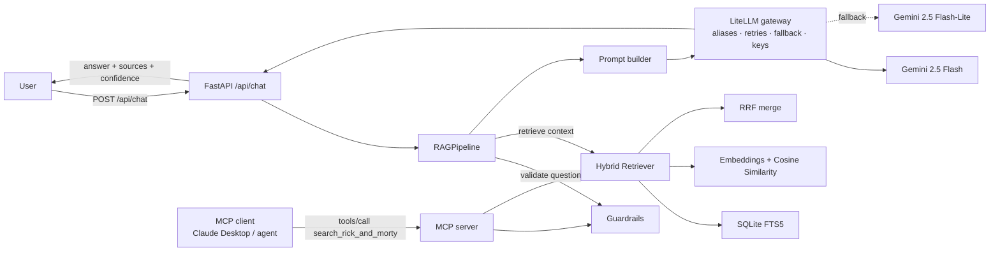

# Interdimensional Oracle

[](https://github.com/poojadinesh99/interdimensional-oracle/blob/main/LICENSE)

Hybrid-retrieval RAG chatbot (FTS5 + embeddings + RRF) with a FastAPI backend. Model calls go through a **LiteLLM gateway**, and the retrieval is also exposed as an **MCP tool** so any MCP client or agent can use it.
---

## Architecture



---

## LiteLLM gateway

The app does not call a model provider directly. With `LLM_PROVIDER=litellm` it sends OpenAI-format
requests to a [LiteLLM](https://github.com/BerriAI/litellm) proxy using a **model alias**
(`MODEL_NAME=oracle-default`). The gateway (`gateway/litellm_config.yaml`) decides what that alias means:

| Alias | Routes to | Purpose |
|---|---|---|
| `oracle-default` | `gemini/gemini-2.5-flash` | primary model, 2 retries |
| `oracle-fallback` | `gemini/gemini-2.5-flash-lite` | automatic fallback if the primary fails |
| `oracle-mock` | fixed mock response | local runs and CI without an API key |

What this buys:
- **Provider keys live only in the gateway.** The app holds a gateway key (`LITELLM_API_KEY`).
- **Swapping or adding models is a config change**, not a code change: point `oracle-default` at another provider and restart the gateway.
- **Retries and fallback** are handled by the gateway's router.
- Requests are tagged (`interdimensional-oracle`, `rag-answer`) for LiteLLM's logging. Per-key virtual keys, budgets and persisted spend logs need a database: add `DATABASE_URL` (Postgres) to the gateway env.
- Gateway failures surface as **HTTP 502** from `/api/chat` (upstream error), separate from 400 (bad input) and 500 (bug).

`LLM_PROVIDER=gemini` still calls Gemini directly without the gateway.

---

## MCP server

`backend/app/mcp_server.py` is a [Model Context Protocol](https://modelcontextprotocol.io) server with one read-only tool:

**`search_rick_and_morty(query, top_k=3)`** runs the same guardrails and hybrid retrieval as `/api/chat`
and returns structured passages (`id`, `title`, `source`, `score`, `content`). `top_k` is clamped to 1–10.
Guardrail rejections are returned as tool errors, so the client sees the reason.

```bash
python -m backend.app.mcp_server                    # stdio (Claude Desktop, Claude Code, Cursor)
python -m backend.app.mcp_server --http --port 8001 # Streamable HTTP at http://localhost:8001/mcp
```

Claude Desktop (`claude_desktop_config.json`):

```json
{
  "mcpServers": {
    "interdimensional-oracle": {
      "command": "/path/to/interdimensional-oracle/.venv/bin/python",
      "args": ["-m", "backend.app.mcp_server"],
      "cwd": "/path/to/interdimensional-oracle"
    }
  }
}
```

The embedding model is loaded on the first search, not at startup, so the server lists its tools quickly.

---

## Why hybrid retrieval?

This project uses **hybrid retrieval** because each method compensates for the other's weaknesses:

- **Semantic (embeddings + cosine similarity)**
  - Helps when the wording in the question doesn’t match the document text closely.
- **Lexical (SQLite FTS5 keyword search)**
  - Helps when the question contains specific names/terms (“Rick”, “Citadel of Ricks”, etc.).
- **RRF (Reciprocal Rank Fusion)**
  - Combines both ranked lists into a single robust ordering without needing a hard weighting/tuning upfront.

---

## Retrieval Strategy

The application uses a hybrid retrieval approach:

1. **SQLite FTS5** for exact keyword matching (character names, episode codes, locations).
2. **Sentence-Transformers (all-MiniLM-L6-v2)** for semantic similarity over precomputed embeddings.
3. **Reciprocal Rank Fusion (RRF)** combines both ranked lists into the final result.

### Why this approach?

- **FTS5 is efficient** for exact entity lookup (names/titles).
- **Embeddings improve retrieval** for natural language phrasing and paraphrases.
- **RRF combines lexical + semantic rankings** without requiring complex score calibration.

For a dataset of ~1000 documents, **SQLite + local embeddings** provides a lightweight solution without requiring an external vector database.

---

## Setup instructions

### 1) Prerequisites
- Python 3.10+ (required by the MCP SDK)
- Docker (for the LiteLLM gateway)
- Internet access (required once for ingestion if you regenerate the knowledge base)

### 2) Gemini API key
Create a Gemini API key in **Google AI Studio**.

Copy `backend/.env.example` to `backend/.env` and set at minimum:

```env
LLM_PROVIDER=litellm
MODEL_NAME=oracle-default        # or oracle-mock to run without an API key
LITELLM_BASE_URL=http://localhost:4000
LITELLM_MASTER_KEY=sk-change-me  # read by the gateway
LITELLM_API_KEY=sk-change-me     # sent by the app
GOOGLE_API_KEY=your_api_key_here # read by the gateway
```

> Note: the app loads `backend/.env` automatically at startup. The gateway reads the same file via `docker-compose.yml`.
> To skip the gateway, set `LLM_PROVIDER=gemini` and `MODEL_NAME=gemini-2.5-flash`.

### 3) Knowledge base artefacts
Ensure these artefacts exist locally:
- `backend/data/oracle.db`
- `backend/data/embeddings.npy`
- `backend/data/embeddings.ids.json`


### 4) Run locally

```bash
python -m venv .venv
source .venv/bin/activate
pip install -r requirements.txt
docker compose up -d litellm        # model gateway on :4000
uvicorn backend.app.main:app --reload --port 8000
```

Then open http://127.0.0.1:8000 (the API serves the frontend).

### 5) Tests

```bash
pip install pytest anyio
python -m pytest tests
```

Covers the gateway client (request format, auth header, error handling) and the MCP tool (schema, structured output, `top_k` clamping, guardrails).

---

## Known limitations

- **Scope limited to the local Rick & Morty knowledge base** (from ingestion). If a question is outside the stored documents, retrieval may return nothing.
- **Retrieval quality depends on embeddings artefacts** being present and consistent with the stored DB.
- **No multi-turn conversation memory**: each request is independent.
- **FTS5 query behavior can vary by SQLite build/version** (handled safely in code, but it’s still SQLite-dependent).

---

## Future improvements

- **Dynamic browse mode backed by SQLite** (instead of static mock data).
- **Streaming responses** from Gemini.
- **Conversation memory** (session-based chat history + summarization).
- **Cross-encoder re-ranking** for higher precision after the hybrid retrieval step.
- **Docker deployment** (pin python/OS deps + simplify local setup).
- **More automated tests** (API contract tests + retrieval smoke tests).
- Expose `ask_oracle` (full RAG answer) as a second MCP tool, routed through the gateway.
- Add observability: request IDs, structured logging, and retrieval debug endpoints.


